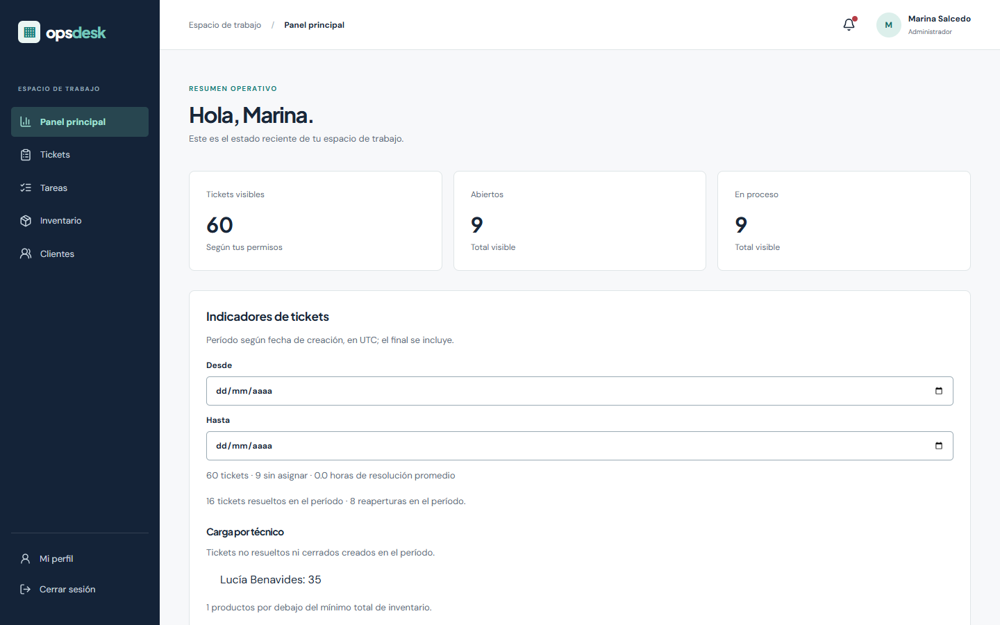

# OpsDesk

OpsDesk es una aplicación de soporte y operaciones para registrar solicitudes, coordinarlas entre roles y conservar evidencia del trabajo. Integra tickets, inventario y tareas en una instancia con SQLite. Es un proyecto demostrable; no se presenta como un servicio público ni se atribuyen usuarios o resultados comerciales.



## Funciones

- Tickets con estados explícitos, asignación, comentarios públicos e internos, adjuntos y actividad.
- Materiales por ubicación, movimientos transaccionales, equipos identificados por serie y consumo asociado a tickets.
- Tareas, avisos persistentes y actualizaciones mediante Socket.IO autenticado.
- Indicadores sobre datos visibles, filtros de fecha y exportación CSV con protección ante fórmulas.
- Roles, sesiones, CSRF, límites de entrada, auditoría y control de concurrencia e idempotencia.

La captura anterior procede de una base ficticia local. La [captura de inventario](docs/assets/inventario-demo.png) muestra el mismo entorno. No hay una demostración pública desplegada.

## Stack y arquitectura

React, TypeScript, Vite, TanStack Query, React Router, Recharts y Socket.IO en el navegador; Node.js, Express, Zod, Drizzle ORM, SQLite (`better-sqlite3`) y Socket.IO en el servidor. Vitest, Supertest, Playwright y Axe se usan en pruebas. Nginx sirve la interfaz y hace proxy a la API y WebSocket. Las rutas comprueban permisos; los servicios de dominio y las transacciones conservan las reglas operativas.

```text
apps/api/             API, módulos de negocio, migraciones y pruebas
apps/web/             Interfaz React y pruebas Playwright
packages/shared/      Contratos de tipos compartidos
infrastructure/       Imágenes y configuración Nginx
docs/                 Arquitectura, operación, seguridad y portafolio
scripts/              Rotación de copias y pruebas
```

La [arquitectura](docs/architecture/overview.md), las [decisiones](docs/architecture/decisions.md) y la [guía de módulos](docs/architecture/module-guide.md) describen la organización y sus límites.

## Requisitos y ejecución local

Node.js 26.13.0 y pnpm 11.25.0 son las versiones fijadas en CI e imágenes. Las dependencias nativas deben instalarse para la versión de Node y el sistema operativo de destino. Docker es opcional para el desarrollo local. Desde la raíz:

```sh
pnpm install --frozen-lockfile
pnpm --filter @opsdesk/api db:migrate
pnpm dev
```

Abrir `http://127.0.0.1:5173`. La API escucha en `127.0.0.1:3001` y usa por defecto `apps/api/data/opsdesk.db`. Las variables de [.env.example](.env.example) se pasan al proceso: el archivo no se carga automáticamente. El directorio de base y adjuntos debe ser persistente y escribible.

Para una base nueva, crea el primer administrador con la tabla de usuarios vacía:

```powershell
$env:BOOTSTRAP_NAME = Read-Host 'Nombre completo'
$env:BOOTSTRAP_EMAIL = Read-Host 'Correo'
$env:BOOTSTRAP_PASSWORD = Read-Host 'Contraseña de al menos 12 caracteres' -MaskInput
pnpm --filter @opsdesk/api db:bootstrap
Remove-Item Env:BOOTSTRAP_PASSWORD
```

En desarrollo `MAIL_MODE=file` guarda mensajes ficticios localmente; no envía correo. El uso real requiere proveedor SMTP y HTTPS. La documentación y el contrato OpenAPI están en `/api/v1/docs` y `/api/v1/openapi.json` para administradores.

## Pruebas

```sh
pnpm format:check
pnpm lint
pnpm typecheck
pnpm check:cycles
pnpm test
pnpm --filter @opsdesk/api test:coverage
pnpm test:rotation
pnpm build
pnpm --filter @opsdesk/web exec playwright install chromium
pnpm --filter @opsdesk/web test:e2e
```

Los escenarios que escriben datos requieren una base de demostración aislada y variables explícitas; la guía de [pruebas](docs/operations/testing.md) explica cómo ejecutarlos. Las pruebas generales omiten esos escenarios si no se configura el entorno. El informe de cobertura está en `apps/api/coverage/`.

## Docker y demostración

```sh
docker compose build
docker compose run --rm api node dist/migrate.js
docker compose up -d --wait
```

El frontend se publica solo en `127.0.0.1:8080`; el puerto 3001 de la API queda dentro de la red de Compose. El volumen `opsdesk-data` conserva la base y los adjuntos. En un servidor externo se requiere un proxy HTTPS y `APP_ORIGIN` con el origen público exacto. Hay procedimientos y precauciones en [despliegue](docs/operations/deployment.md), [copias y restauración](docs/operations/backups.md) y [demostración](docs/portfolio/demo.md).

Los datos `db:seed` son exclusivamente ficticios, exigen una base vacía y se prohíben con `NODE_ENV=production`. No publiques las cuentas de demostración privilegiadas ni las conectes a datos reales.

## Seguridad y límites

Consulte la [matriz de controles](docs/operations/security-asvs.md), el [modelo de seguridad](docs/architecture/security-model.md) y el [estado de límites](docs/roadmap.md). La validación de archivos por firma no es análisis antimalware. No se afirma certificación ASVS, cumplimiento integral de accesibilidad ni disponibilidad de un despliegue público. Las copias SQLite no incluyen por sí solas los archivos adjuntos.

## Portafolio y licencia

La [presentación técnica](docs/portfolio/overview.md), el [guion de demostración](docs/portfolio/demo.md) y la [evaluación final](docs/operations/evaluation.md) describen evidencias y limitaciones sin inventar métricas de negocio. El código se distribuye bajo [MIT](LICENSE).
