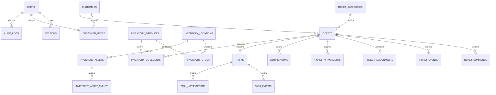

# Modelo de datos

Las tablas implementadas se definen en `apps/api/src/schema.ts` y las migraciones en `apps/api/drizzle/`. Usan UUID como identificador principal; los tickets tienen además un número secuencial. SQLite aplica claves foráneas, comprobaciones y restricciones únicas. Las fechas de la aplicación se expresan como texto UTC ISO 8601.

| Grupo               | Entidades y restricciones destacadas                                                                                                                                                                                                           |
| ------------------- | ---------------------------------------------------------------------------------------------------------------------------------------------------------------------------------------------------------------------------------------------- |
| Identidad           | `users`, `sessions`, `customer_users`, `password_resets`; roles y estado restringidos, huellas de sesión y tokens únicas.                                                                                                                      |
| Atención            | `customers`, `ticket_categories`, `tickets`, `ticket_comments`, `ticket_events`, `ticket_assignments`, `ticket_attachments`, `counters`; historial persistente, número de ticket único y clave de reintento de comentario única cuando existe. |
| Inventario fungible | `inventory_products`, `inventory_locations`, `inventory_stock`, `inventory_movements`, `inventory_alerts`; stock por producto y ubicación único y no negativo, movimientos con `request_id` único.                                             |
| Equipos             | `inventory_assets`, `inventory_asset_events`; serie única, responsable y ticket opcionales, historial propio.                                                                                                                                  |
| Tareas y avisos     | `tasks`, `task_events`, `task_notifications`, `notifications`; responsable, estado, vencimiento y destinatario con claves foráneas.                                                                                                            |
| Auditoría           | `audit_logs`, `security_events`; separación entre acciones de negocio y eventos de seguridad. No hay endpoints de edición de auditoría.                                                                                                        |

El diagrama omite varias referencias a actores para favorecer la lectura; el esquema Drizzle es la fuente de verdad. El archivo privado de un adjunto no está en SQLite: la tabla conserva su identificador y metadatos, por lo que el respaldo operativo debe incluir la base y el directorio de adjuntos.
