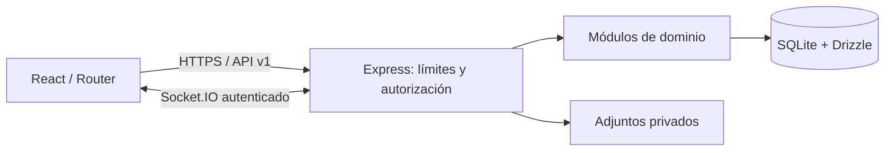

# Arquitectura

Monolito modular para una organización. React/Vite sirve la interfaz; Express expone `/api/v1`; los módulos de dominio agrupan rutas, validación y reglas de tickets, inventario, tareas y reportes. Drizzle y better-sqlite3 concentran persistencia; `packages/shared` contiene un paquete de apoyo, sin dependencia actual desde las aplicaciones. No existe acceso directo a SQLite desde el navegador.

Errores públicos: `{error:{code,message}}`, sin detalles internos. Configuración validada al iniciar; secretos por entorno, no en Git. Pino registra errores estructurados; no registrar cuerpos ni credenciales. Cada respuesta de error incluye identificador de solicitud; las mutaciones de negocio implementadas generan auditoría transaccional. Pruebas: Vitest unitarias, Supertest integración y Playwright recorridos accesibles; CI reproduce comprobaciones. La API expone salud de proceso y una comprobación separada de disponibilidad de SQLite y tablas seleccionadas. Las migraciones se versionarán con cada esquema real; no hay migraciones vacías.

SQLite simplifica operación, consistencia y despliegue de una sola instancia; WAL mejora concurrencia de lectores pero sigue habiendo un escritor. Medir latencia y contención; migrar a un servidor de base de datos si la carga, disponibilidad o despliegue multiinstancia lo exige. No usar el archivo en almacenamiento de red sin validar sus garantías de bloqueo.
