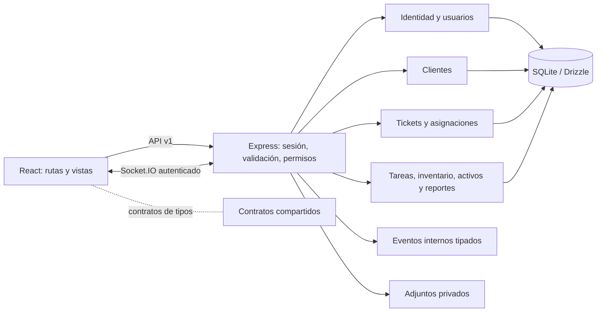

# Arquitectura

OpsDesk es un monolito modular para una organización: React/Vite consulta Express y Socket.IO; la API valida entradas, aplica permisos y persiste en SQLite mediante Drizzle. El navegador no accede directamente a SQLite. Se conserva una única instancia escritora; los módulos son límites de código, no servicios distribuidos.

`apps/api/src/modules` agrupa identidad, clientes, tickets, tareas, inventario, activos, notificaciones, auditoría y reportes. Identidad y clientes tienen servicios propios; tickets agrupa servicio, asignaciones, adjuntos y ciclo de vida. Las rutas de tareas, inventario, activos y reportes aún combinan validación, coordinación y persistencia; separar esas responsabilidades es trabajo incremental, no se presentan como capas completas. `routes.ts` compone los módulos y conserva rutas de usuarios, clientes, tickets y perfil. `schema.ts`, `db.ts`, configuración y errores comunes pertenecen a la infraestructura de la aplicación.

React mantiene el proveedor de sesión y la composición de rutas en `app`; `features/workspace` separa navegación, avisos, panel, directorio, listado y detalle; `features` agrupa además tickets, clientes, panel, inventario y tareas con sus componentes. `packages/shared` proporciona contratos de tipos para roles, estados y paginación; Zod sigue siendo la validación del servidor. No hay garantía de que todos los DTO estén unificados todavía.

Los eventos de `domain-events.ts` son señales tipadas, en memoria y sin datos sensibles, publicadas por rutas después de confirmar la operación. Hay eventos para creación, asignación y resolución de tickets, actualización de cliente, movimiento y tarea completada; las repeticiones idempotentes de movimientos no generan un evento nuevo. Un suscriptor defectuoso se aísla del resultado HTTP. No son persistentes ni una cola transaccional: un cierre del proceso puede perderlos y los consumidores deben tolerar fallos. Auditoría y notificaciones existentes siguen guardándose en la transacción SQLite; Socket.IO mantiene su mecanismo de señalización independiente. Ver [guía de módulos](module-guide.md).

Cada error HTTP incluye identificador de solicitud, sin detalles internos de persistencia; Pino no registra cuerpos ni credenciales. Las migraciones se aplican explícitamente y no se reconstruyen bases durante el arranque. WAL permite lectores concurrentes, pero SQLite mantiene un escritor; la operación en red o multiinstancia necesita evaluación adicional.
